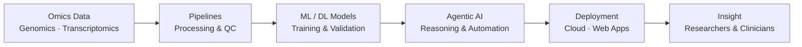

<div align="center">

<a href="https://github.com/mubashir1837"></a>

<br/>


<br/><br/>

<a href="https://mubashirali.vercel.app/"></a>
<a href="https://linkedin.com/in/mubashirali3/"></a>
<a href="https://scholar.google.com/citations?user=cSRYdWAAAAAJ"></a>
<a href="https://mubashirali.vercel.app/contact.html"></a>

</div>

---

## `> whoami`

```python
class MubashirAli:
    role      = ["AI Engineer", "Bioinformatician", "Full-Stack Developer"]
    founder   = ["TynexAI", "Code with Bismillah"]
    focus     = ["Agentic AI", "Multi-Omics", "Genomics", "Transcriptomics", "Precision Medicine"]
    stack     = ["Python", "TypeScript", "Next.js", "Cloud ML Deployment"]
    mission   = "Turn complex biological data into actionable, deployable intelligence."
    seeking   = "Collaborations with professors & labs in AI/ML, multi-omics, computational genomics"

    def build(self):
        return "Algorithms → Pipelines → Products researchers & clinicians can actually use"
```

<p>I work at the intersection of <b>artificial intelligence and life sciences</b>: building computational tools that speed up discovery and sharpen decision-making in healthcare. I deploy and scale ML/DL models on modern cloud platforms, and I ship end-to-end applications with <b>TypeScript and Next.js</b>, so research doesn't stay stuck in notebooks.</p>

---

## `> pipeline`



---

## `> ventures & projects`

<table>
  <tr>
    <td width="50%" valign="top">
      <h3>🧬 GeneFix AI</h3>
      <p>AI-driven genomics research, published as a preprint on <b>bioRxiv</b>.</p>
      <a href="https://www.biorxiv.org/content/10.1101/2025.05.04.652132v1"></a>
      <a href="https://www.crunchbase.com/organization/genefixai"></a>
    </td>
    <td width="50%" valign="top">
      <h3>🏢 TynexAI</h3>
      <p>AI services enterprise delivering applied machine learning and intelligent software.</p>
      <a href="https://www.crunchbase.com/organization/tynexai"></a>
    </td>
  </tr>
  <tr>
    <td width="50%" valign="top">
      <h3>🐍 BioBuntu</h3>
      <p>Python package for bioinformatics workflows, available on PyPI.</p>
      <a href="https://pypi.org/project/biobuntu/"></a>
      <a href="https://www.saashub.com/biobuntu"></a>
    </td>
    <td width="50%" valign="top">
      <h3>🎨 BismillahCSS</h3>
      <p>Open-source CSS toolkit published on npm.</p>
      <a href="https://www.npmjs.com/package/bismillahcss"></a>
      <a href="https://www.saashub.com/bismillahcss"></a>
    </td>
  </tr>
  <tr>
    <td width="50%" valign="top">
      <h3>🎓 Code with Bismillah</h3>
      <p>Ed-tech platform dedicated to advancing knowledge in data science, programming and bioinformatics.</p>
      <a href="https://www.codewithbismillah.online"></a>
      <a href="https://www.linkedin.com/company/code-with-bismiallah/"></a>
    </td>
    <td width="50%" valign="top">
      <h3>🔬 Bio Data Hub</h3>
      <p>A platform for biological data exploration and resources.</p>
      <a href="https://bio-data-hub.vercel.app/"></a>
    </td>
  </tr>
</table>

<div align="center">
  <p>📖 <b>Author of <i>The Genome Story</i></b></p>
  <a href="https://www.amazon.com/Genome-Story-Mubashir-Ali/dp/B0GDKDW884"></a>
</div>

---

## `> tech_stack`

<div align="center">
  <p><b>🧠 AI / Data / Bio</b></p>
  
  <p><b>🌐 Full-Stack</b></p>
  
  <p><b>☁️ Deployment &amp; Tools</b></p>
  
</div>

---

## `> github_analytics`

<div align="center">
  
  <br/>
  
  
  <br/>
  
  
  
    
</div>

---

## `> research_and_academic`

<div align="center">
  <a href="https://scholar.google.com/citations?user=cSRYdWAAAAAJ"></a>
  <a href="https://orcid.org/0009-0006-0222-7585"></a>
  <a href="https://www.researchgate.net/profile/Mubashir-Ali-31"></a>
  <a href="https://www.biorxiv.org/content/10.1101/2025.05.04.652132v1"></a>
  <a href="https://www.semanticscholar.org/author/Mubashir-Ali/2361732131"></a>
  <a href="https://qau.academia.edu/MubashirAli"></a>
  <a href="https://loop.frontiersin.org/people/3198868"></a>
  <a href="https://www.webofscience.com/wos/author/record/OEN-7503-2025"></a>
  <a href="https://sciety.org/articles/activity/10.1101/2025.05.04.652132"></a>
  <br/><br/>
  <p>🔭 <b>Currently seeking collaborations</b> with professors and research labs at the frontier of <b>AI/ML, multi-omics and computational genomics</b>. If that's you, <a href="https://mubashirali.vercel.app/contact.html">let's talk</a>.</p>
</div>

---

## `> open_source_and_coding`

<div align="center">
  <a href="https://pypi.org/project/biobuntu/"></a>
  <a href="https://www.npmjs.com/package/bismillahcss"></a>
  <a href="https://marketplace.visualstudio.com/publishers/Mubashir-Ali"></a>
  <a href="https://huggingface.co/mubashir1837"></a>
  <a href="https://www.kaggle.com/mubashir1837"></a>
  <a href="https://leetcode.com/u/mubashir1837/"></a>
  <a href="https://www.hackerrank.com/profile/mubashir1837"></a>
  <a href="https://www.datacamp.com/portfolio/mubashir1837"></a>
  <a href="https://www.coursera.org/learner/mubashir1837"></a>
  <a href="https://www.credly.com/users/mubashir1837"></a>
  <a href="https://www.bohrium.com/user/mubashir1837"></a>
</div>

---

## `> writing_and_content`

<div align="center">
  <a href="https://www.amazon.com/author/mubashiali"></a>
  <a href="https://www.goodreads.com/author/show/67799666.Mubashir_Ali"></a>
  <a href="https://mubashir1837.substack.com/"></a>
  <a href="https://mubashir1837.hashnode.dev/"></a>
  <a href="https://medium.com/@mubashir1837"></a>
  <a href="https://dev.to/mubashir1837"></a>
  <a href="https://www.youtube.com/@BioWithMubashirAli"></a>
</div>

---

## `> hire_and_connect`

<div align="center">
  <a href="https://www.upwork.com/freelancers/~0155a27ec55b615628"></a>
  <a href="https://www.upwork.com/agencies/1918288291912185024/"></a>
  <a href="https://www.fiverr.com/mubashir183"></a>
  <a href="https://linkedin.com/in/mubashirali3/"></a>
  <a href="https://x.com/mubashir1837"></a>
  <a href="https://www.instagram.com/mubashir18377/"></a>
  <a href="https://www.facebook.com/mubashir1837"></a>
  <a href="https://www.tiktok.com/@mubashir.1837/"></a>
  <a href="https://whatsapp.com/channel/0029Vag7XYc6LwHkv1yfVo3A"></a>
  <a href="https://linktr.ee/mubashir1837"></a>
</div>

<br/>

<details>
  <summary><b>📂 Extended directory &amp; mentions</b></summary>
  <br/>
  <ul>
    <li><b>Profiles:</b>
      <a href="https://mubashir1837.carrd.co/">Carrd</a> ·
      <a href="https://about.me/mubashir1837/">About.me</a> ·
      <a href="https://www.wikidata.org/wiki/Q135921355">Wikidata</a> ·
      <a href="https://commons.wikimedia.org/wiki/File:Mubashir_Ali_-_Pakistani_Bioinformatician.jpg_01.jpg">Wikimedia Commons</a> ·
      <a href="https://www.ted.com/profiles/50451970">TED</a>
    </li>
    <li><b>Startup &amp; Dev:</b>
      <a href="https://www.producthunt.com/@mubashir1837/">Product Hunt</a> ·
      <a href="https://www.f6s.com/mubashir1837">F6S</a> ·
      <a href="https://devpost.com/mubashir1837">Devpost</a> ·
      <a href="https://lablab.ai/u/@mubashir1837">Lablab.ai</a> ·
      <a href="https://forem.com/mubashir1837">Forem</a>
    </li>
    <li><b>Reviews &amp; Mentions:</b>
      <a href="https://www.trustpilot.com/review/codewithbismillah.online">Trustpilot</a> ·
      <a href="https://www.provenexpert.com/code-with-bismillah/">ProvenExpert</a> ·
      <a href="https://en.everybodywiki.com/Code_with_Bismillah">EverybodyWiki</a> ·
      <a href="https://www.quora.com/profile/Mubashir-Ali-959">Quora</a>
    </li>
    <li><b>Directories:</b>
      <a href="https://www.saashub.com/biobuntu">SaaSHub · BioBuntu</a> ·
      <a href="https://www.saashub.com/bismillahcss">SaaSHub · BismillahCSS</a>
    </li>
  </ul>
</details>

---

## `> support`

<div align="center">
  <a href="https://github.com/sponsors/mubashir1837"></a>
  <a href="https://www.patreon.com/c/mubashir1837"></a>
  <a href="https://opencollective.com/mubashir1837"></a>
  <br/><br/>
  
</div>


